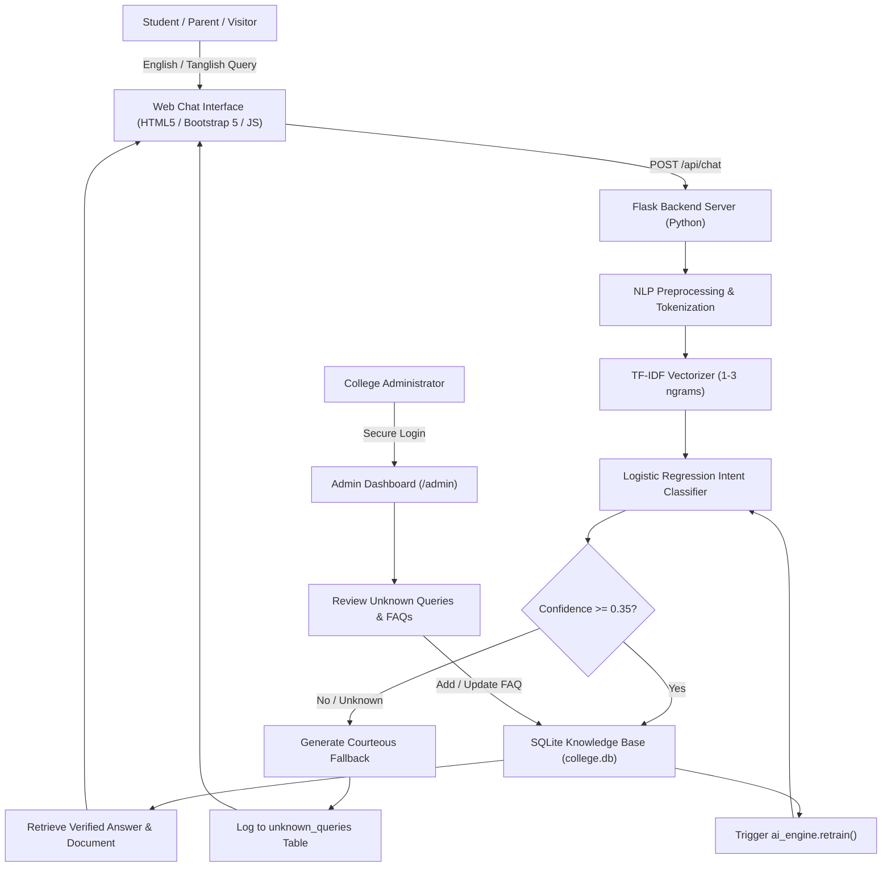

# 🎓 College Chatbot Using AI — Intelligent Virtual Assistant

An AI-powered conversational college enquiry system developed using **Natural Language Processing (NLP)**, **TF-IDF Vectorization**, and **Logistic Regression Intent Classification** with dual-language support for **English** and **Tanglish** (Tamil written in English script).

The system features a **modern college portal website**, a **WhatsApp-inspired floating chat widget**, a **dedicated full-screen Figma AI workspace (`/chat`)**, a **SQLite knowledge base**, and a **secure administrative control dashboard (`/admin`)** with dynamic in-memory AI model retraining.

---

## 📋 Table of Contents
1. [Project Overview & Abstract](#-project-overview--abstract)
2. [Key Features](#-key-features)
3. [System Architecture & Data Flow](#-system-architecture--data-flow)
4. [NLP & Machine Learning Pipeline](#-nlp--machine-learning-pipeline)
5. [Database Schema (SQLite)](#-database-schema-sqlite)
6. [Figma-Inspired AI Chatbot Workspace](#-figma-inspired-ai-chatbot-workspace)
7. [Admin Portal & Dynamic Retraining](#-admin-portal--dynamic-retraining)
8. [Live Demonstration Flow](#-live-demonstration-flow)
9. [Installation & Local Setup](#-installation--local-setup)
10. [Running Automated Tests](#-running-automated-tests)

---

## 🌟 Project Overview & Abstract

In traditional colleges, students and parents face difficulties obtaining timely and accurate information regarding admissions, fee structures, courses, exam schedules, hostel facilities, and placements. Enquiries require physical visits, office calls, or navigating complex static web menus during working hours.

**College Chatbot Using AI** eliminates these bottlenecks by providing:
- **24/7 Virtual Assistance** responding in under 1.5 seconds.
- **Natural Language & Tanglish Comprehension** understanding queries such as *"CSE ku fees evlo?"*, *"Hostel available ah?"*, or *"Placement details venum"*.
- **Admin Knowledge Control** allowing authorized staff to add, edit, and delete FAQs without touching source code.
- **Continuous Learning** for unknown queries, logging unclassified questions for administrator review and immediate knowledge base updates.

---

## ✨ Key Features

- **College Landing Page (`/`):**
  - Modern dark navy (`#0a192f`) and white theme with teal (`#0d9488`) and electric blue accents.
  - Institutional overview, accreditation badges, and TNEA counselling code (`3462`).
  - Dedicated cards for Admissions, Courses, Fees, Facilities, Hostels, Transport, and Placements.
  - Interactive visual diagrams for How It Works, System Architecture, and Technology Stack.
- **Floating WhatsApp-Style Chatbot:**
  - WhatsApp bubble interface with distinct student and bot avatars, timestamps, and typing animation dots.
  - Suggested question chips and instant reply retrieval from SQLite.
- **Dedicated Figma AI Workspace (`/chat`):**
  - Left navigation sidebar with `+ New Chat`, topic shortcuts, and admin link.
  - Model selector pills: `[TF-IDF + Logistic Reg]`, `[English & Tanglish]`, `[SQLite DB]`.
  - Background watermark branding (`AIVA CHATBOT`).
  - 6 initial suggestion prompt cards.
  - Right sidebar: *"Generated Links of Websites and Documents will appear here"* displaying relevant brochures, PDF fee structures, and portals.
  - Text-to-speech audio playback and copy-to-clipboard buttons.
- **Secure Admin Dashboard (`/admin/dashboard`):**
  - Password hashing with PBKDF2:SHA256.
  - Real-time KPI metrics: Total FAQs, queries received, unanswered queries, resolution rate.
  - Interactive Chart.js charts: Category distribution, answered vs. unanswered, language breakdown, top intent trends.
  - FAQ CRUD operations with automatic in-memory model retraining in <0.1s.
  - Unknown queries review with 1-click conversion to verified FAQ.

---

## 📐 System Architecture & Data Flow



### UML DFD Hierarchy
1. **Level 0 DFD (Context Diagram):** External entities (Student and Admin) communicating with Process 0 (College Chatbot System).
2. **Level 1 DFD:** Breaks down into Input Processing, NLP Feature Extraction, Intent Classification, Knowledge Base Search, and Admin Knowledge Management.

---

## 🧠 NLP & Machine Learning Pipeline

### 1. Preprocessing & Normalization
- Converts text to lowercase and strips non-alphanumeric noise.
- Normalizes Tanglish colloquialisms into canonical intent tokens:
  - `evalo`, `evlo`, `evvalavu` $\rightarrow$ `evlo`
  - `irukka`, `irukku` $\rightarrow$ `iruka`
  - `venum`, `vaenum` $\rightarrow$ `venum`
  - `sollunga`, `sollu` $\rightarrow$ `sollunga`
  - `eppadi`, `epdi` $\rightarrow$ `eppadi`

### 2. Feature Extraction (TF-IDF Vectorizer)
- Extracts word n-grams (1, 3) with sublinear term-frequency scaling.
- Formula:
  $$\text{TF-IDF}(t, d, D) = \text{TF}(t, d) \times \log\left(\frac{1 + |D|}{1 + |\{d \in D : t \in d\}|}\right) + 1$$

### 3. Classification (Logistic Regression)
- Multi-class classifier trained with balanced class weights:
  $$P(y = k \mid \mathbf{x}) = \frac{e^{\mathbf{w}_k^T \mathbf{x}}}{\sum_{j=1}^{K} e^{\mathbf{w}_j^T \mathbf{x}}}$$
- Blends Softmax probabilities with Cosine Similarity against verified question patterns.
- If effective confidence $\ge 0.35$, the verified database answer is returned.
- If confidence $< 0.35$, the fallback response triggers and the query is queued for admin review.

---

## 🗄️ Database Schema (SQLite)

- **`faqs`**: `id`, `intent`, `question`, `answer`, `category`, `tanglish_variations`, `doc_link`, `doc_title`, `created_at`, `updated_at`
- **`admin`**: `id`, `username`, `password_hash`, `email`, `role`, `created_at`
- **`unknown_queries`**: `id`, `query_text`, `predicted_intent`, `confidence`, `status`, `admin_answer`, `timestamp`
- **`chat_history`**: `id`, `session_id`, `user_query`, `bot_response`, `intent`, `confidence`, `category`, `language`, `timestamp`
- **`college_settings`**: `key`, `value` (Institutional metadata, contact, address, TNEA code)

---

## 🎯 Live Demonstration Flow

Follow this step-by-step sequence to demonstrate the system:

1. **Launch the Application:** Start `python app.py` and open `http://127.0.0.1:5000`.
2. **Explore College Website:** Review verified admission procedures, courses, fee structures, facilities, and the animated pipeline diagram.
3. **Open Floating Chatbot:** Click the WhatsApp icon in the bottom-right corner.
4. **Test Tanglish Fee Query:**
   - Query: `CSE ku fees evlo?`
   - Response: `Computer Science and Engineering (CSE) tuition fee is ₹75,000 per academic year...`
5. **Test Hostel Facilities Query:**
   - Query: `Hostel available ah?`
   - Response: Verified boys/girls hostel facilities, mess food, and ₹60,000 annual fee.
6. **Open Dedicated Figma AI Workspace:** Click *"Full Screen"* or navigate to `http://127.0.0.1:5000/chat`.
   - Test prompt cards and observe the right sidebar dynamically displaying related college documents!
7. **Ask an Unknown Question:**
   - Query: `What about canteen menu?`
   - Response: Polite fallback stating the query has been forwarded to the college office.
8. **Log in to Admin Dashboard:**
   - Open `http://127.0.0.1:5000/admin/login`
   - Credentials: `admin` / `admin123`
9. **Review Unknown Queries:**
   - Under *Unknown Queries*, locate *"What about canteen menu?"*.
   - Click **Add as FAQ**.
   - Input answer: *"The college cafeteria serves fresh vegetarian and non-vegetarian meals from 8:00 AM to 5:00 PM."*
   - Save the FAQ. The model retrains automatically in under 0.1 seconds!
10. **Verify Retraining:**
    - Return to the chat window and ask `What about canteen menu?` again.
    - Notice that the chatbot now immediately returns the verified canteen answer!

---

## 🚀 Installation & Local Setup

### Prerequisites
- Python 3.9 or higher
- Git

### 1. Clone Repository & Navigate
```bash
git clone <repository-url>
cd "College chatbot using AI"
```

### 2. Install Required Dependencies
```bash
pip install -r requirements.txt
```

### 3. Initialize SQLite Database
```bash
python database.py
```

### 4. Run Flask Server
```bash
python app.py
```
Open your browser and navigate to:
- **Public Website:** `http://127.0.0.1:5000/`
- **Figma AI Workspace:** `http://127.0.0.1:5000/chat`
- **Admin Portal:** `http://127.0.0.1:5000/admin/login` (`admin` / `admin123`)

---

## 🧪 Running Automated Tests

A comprehensive automated test suite validates database tables, NLP intent classification, English and Tanglish processing, unknown query fallback, and dynamic retraining:

```bash
python test_college_chatbot.py
```

**Expected output:**
```
Ran 6 tests in 0.926s
OK
```

---

## 🛡️ Security & Performance
- **Password Protection:** PBKDF2:SHA256 password hashing via Werkzeug.
- **SQL Injection Prevention:** 100% parameterized queries via SQLite3 cursor bindings.
- **Sub-Second Latency:** In-memory TF-IDF vectorization and Logistic Regression inference responding in under 1.5 seconds.
- **Responsive Layout:** Optimized with Bootstrap 5 across mobile, tablet, and desktop screens.
